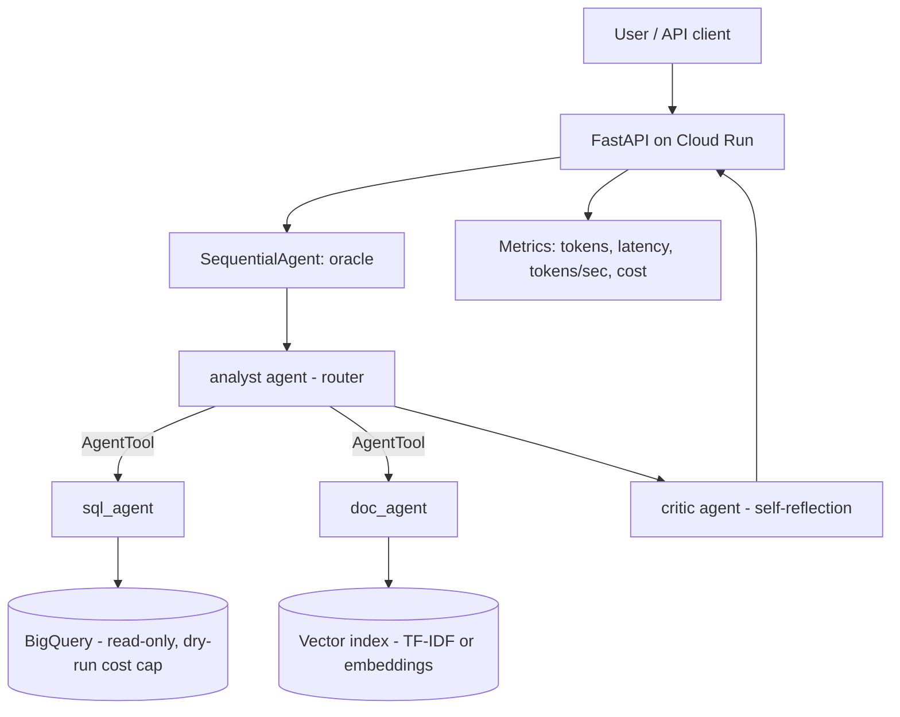

# ORACLE architecture

## Design decisions
- **Hierarchical delegation:** the analyst treats specialists as tools, so each has a narrow prompt and toolset.
- **Safety:** SQL is validated (single SELECT only), dry-run for cost, `maximum_bytes_billed` enforced, and the runtime service account is read-only.
- **Grounding:** the doc agent may only answer from retrieved passages and must cite chunk IDs; the critic rejects unsupported claims.
- **Observability:** ADK callbacks record tokens and tool calls per request.

## Known limitations (be honest about these in interviews)
- The critic checks the draft's internal consistency; it does not re-run retrieval yet (next step: give it search_documents).
- Retrieval is TF-IDF by default; the embeddings backend is a simple in-memory index.
- Sessions are in memory only; use a database-backed session service for production.
